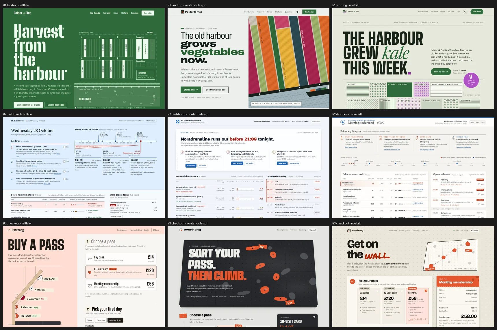

# Blind comparison: telltale, frontend-design, no skill

Run on 2026-10-28. Every builder and every judge was Claude Opus 5.5.

## Setup

- **Three briefs** of different kinds (full text in [`briefs.md`](briefs.md)):
  - B1: a landing page for an urban farm (Persuade);
  - B2: a hospital pharmacy's morning stock screen (Operate);
  - B3: a checkout form for a bouldering gym.
- **Three conditions:**
  - `t`: this skill;
  - `f`: the `frontend-design` skill as installed in Claude Code;
  - `n`: no skill.
- **Same input for every builder.** All got the same opening, brief and technical rules, and only the method line
  differed. Each builder had to:
  - deliver one self-contained HTML file;
  - support light and dark themes at 1440 and 390 px;
  - define the brand colour as one `--brand` variable that re-themes the page.

  Builders were not told that they were being compared.
- **The same measurements for every page.** [`run_eval.py`](run_eval.py):
  - renders every page;
  - swaps the brand colour to a dark teal, a light yellow and a red;
  - measures contrast with [`check_contrast.py`](../skills/telltale/scripts/check_contrast.py) in both themes and at
    both widths;
  - counts colour literals outside custom properties;
  - copies the screenshots under random labels X, Y and Z.
- **One fresh judge per brief.** The judge scored the screenshots before opening the measurements, then could adjust
  the scores, then ranked the three ([`judge.md`](judge.md)).
- **Two rounds.**
  - Round 1 used telltale with the new "find the idea" and "make it memorable" sections.
  - Round 2 used telltale after changes based on the round 1 judges' comments: the bold move must carry content,
    large colour fields are derived per theme, the page is filled to the end, and beauty is critiqued before the checks.
  - The `f` and `n` pages are the same files in both rounds. Only the telltale pages and the judges are new.

## Results

Average of the three briefs. Judge scores are 1 to 10, given before the judge opened the measurements. Rank is 1 to 3.

| | Round 1: telltale | Round 2: telltale | frontend-design (R1 / R2 judges) | no skill (R1 / R2 judges) |
| --- | --- | --- | --- | --- |
| Average rank | 1.33 | **1.00** | 2.33 / 2.67 | 2.33 / 2.33 |
| Not AI-generated looking | 7.3 | **8.0** | 6.7 / 6.0 | 7.0 / 6.3 |
| Beauty | 6.7 | 7.0 | 7.3 / 7.0 | 8.0 / 7.3 |
| Brief fit | 8.7 | **8.7** | 8.3 / 8.0 | 9.0 / 8.3 |
| Re-theme, judged by eye | 7.0 | 7.3 | 7.3 / 6.7 | 8.3 / 7.7 |
| Phone | 8.0 | **8.0** | 6.7 / 6.7 | 6.3 / 6.7 |

Measured contrast in round 2. The table counts the distinct failing colour pairs: text below 4.5:1, or field
boundaries below 3:1. Each page was checked in light and dark themes, at 1440 and 390 px, with the default brand and
with each of the three swapped brands.

| | B1 landing | B2 dashboard | B3 checkout |
| --- | --- | --- | --- |
| telltale | **0** in every theme and brand | **0** | **0** |
| frontend-design | 0 | 3, lowest 1.53:1 | 4–7, lowest 1.36:1 |
| no skill | 9–12, lowest 1.14:1 | 4, lowest 1.25:1 | 5–7, lowest 1.06:1 |

Colour literals outside custom properties in round 2: telltale had 0 in all three briefs. frontend-design had 0, 3 and
11 (B1, B2, B3). No skill had 1, 0 and 0.

## What the judges said

- B2, telltale: "The day timeline is the most original idea here … real pharmacy thinking rather than dashboard
  decoration."
- B1, telltale: "The only one that is both properly authored and works." Its weakness: "below the hero the page goes
  grey and documentary."
- B3, telltale: "The progress indicator is the wall itself." Its weakness: "on desktop the left panel becomes a large
  empty … slab for two-thirds of the page."
- Judges of the other pages named tells such as these:
  - an italic serif word dropped into every heading;
  - rotated sticker badges;
  - mono micro-labels above every section;
  - a "landing-page hero" on a dashboard;
  - text at 1.06:1.

## What this shows, and what it does not

- telltale ranked first in all three briefs in round 2. It is clearly ahead on "not AI-generated looking", phone,
  accessibility and re-theming without colour literals.
- **It is not ahead on beauty.** In round 1 it was the lowest on beauty. After round 2 it is level with
  frontend-design and 0.3 below no skill, which is within the judges' spread: the same `f` and `n` pages got
  scores about 0.5 apart from the two sets of judges.
- One page per brief and condition, and three briefs. This is a signal, not statistics.
- The judges are models of the same family as the builders. They saw the measurements after their first scores, and
  most of them moved scores and ranks on accessibility.
- The telltale builders could run the contrast check themselves. Their 0 failures partly come from using the tool,
  which is the point of the skill, but the other conditions did not have it.
- The runs found and fixed problems in the skill's own tools:
  - `check_contrast.py` failed on `oklch()` colours;
  - it compared labels with their parent's background instead of the layer under them;
  - long phone screenshots were cut off.

## Tasks 4 to 6 (measured only)

After round 2 the set grew to six tasks: a magazine long read, a household budget overview with charts, and a festival
programme with tickets. They were built the same way (three conditions, same prompts, [`briefs.md`](briefs.md) holds
the first three). No model judges scored them: people are asked instead, see [`../human-eval`](../human-eval).
Measured by `run_eval.py`:

| Distinct failing contrast pairs (default / teal / yellow / red) | telltale | frontend-design | no skill |
| --- | --- | --- | --- |
| 4. Long read | 0 / 0 / 0 / 0 | 1 / 1 / 4 / 1 | 2 / 2 / 4 / 2 |
| 5. Budget overview | 0 / 0 / 0 / 0 | 6 / 6 / 6 / 6 | 1 / 1 / 1 / 1 |
| 6. Festival programme | 0 / 0 / 0 / 0 | 0 / 0 / 1 / 1 | 1 / 2 / 2 / 1 |

telltale had no failing pair again. Read this with the same caution as before, and with one more:

- the telltale builders could run the contrast tool, the others could not;
- the tool does not measure text inside SVG. The telltale pages have the most such items (48 to 156 against 24 to 112),
  because they draw their charts and plans in SVG, so their real result is less certain than the 0 suggests. Those
  labels were checked by eye by the builders, not by a tool.

## Reproduce

1. Give each builder the prompt from [`briefs.md`](briefs.md), with the output path `<run>/<brief>/<condition>/index.html`.
2. Run `python evals/run_eval.py <run> --seed <n>`.
3. Give each judge the prompt from [`judge.md`](judge.md) and its `<run>/judge/<brief>/` folder.
4. Map the labels back with `<run>/KEY_do_not_show_judges.json`.

The scores and measurements of both rounds are in [`results.json`](results.json).
